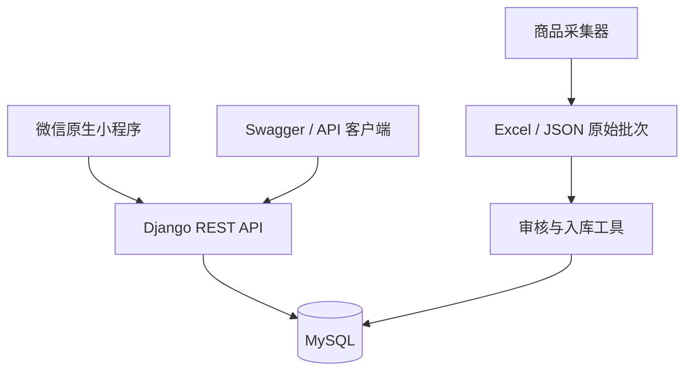

# DigRecSys 数码商品交易系统

DigRecSys 是一个以数码商品目录为核心的交易项目，包含 Django REST API、微信原生小程序、商品采集工具和经审核的数据入库流程。

## 当前功能

### 后端与管理 API

- 用户注册、账号密码登录、Token 认证、个人资料修改、密码修改和头像上传。
- 商品列表、详情、搜索、分类、价格筛选、排序和分页。
- 管理员商品 CRUD、搜索、排序、分页、批量上下架和批量删除。
- 管理员用户列表、搜索、启停筛选、分页和资料编辑。
- 地址、购物车、订单创建、取消、模拟支付、确认收货。
- 管理员订单列表、搜索、状态筛选、详情、发货和批量操作。
- Swagger 和 ReDoc API 文档。

当前没有独立的 Vue/React Web 管理页面，Django Admin 也没有注册业务模型。管理能力以 `/api/admin/` 下的 REST API 为准，不应把它描述成已完成的后台管理界面。

### 微信小程序

- 首页、吸顶搜索栏、分类 tabs、原地搜索、触底分页、错误和空状态。
- 独立分类页支持分类导航、商品数量、触底分页和商品详情跳转。
- 商品详情、产地、动态参数及加入购物车。
- 账号密码注册/登录、个人中心、用户信息与密码修改、头像上传和退出登录。
- 购物车库存上限、滑动删除、选中结算、订单确认和收货地址新增。
- 订单列表、订单详情、取消、模拟支付和确认收货。
- 集中的 API 地址、Token 请求头和错误处理。

### 数据采集与入库

- `crawl/crawl_data.py` 采集商品信息并输出批次快照，不直接写业务数据库。
- `database/import_products.py` 校验审核后的 Excel/JSON，再以事务方式导入商品目录。
- 线上商品只有 `Product` 一套事实来源，动态规格保存在 `all_params` JSON。

## 系统架构



`Product` 是购物车、订单明细和评论共同引用的商品实体。订单明细价格、商品名称及收货地址在下单时保存快照，避免历史订单被后续商品或地址修改影响。

## 技术栈

- Python 3.11.9
- Django 5.2.11
- Django REST Framework 3.16.1
- MySQL 8.0.45、mysqlclient 2.2.7
- django-cors-headers 4.9.0
- drf-yasg 1.21.15
- 微信原生小程序、Vant Weapp 1.11.7
- 商品工具：requests、lxml、openpyxl

以上版本来自当前实际运行环境或锁定的依赖文件。

## 目录结构

```text
DigRecSys/
├── DigRecSys/              Django 设置、根路由、ASGI/WSGI
├── Users/                  用户、认证和管理员用户 API
├── Product/                品牌、分类、商品、评论和商品 API
├── Orders/                 地址、购物车、订单和交易流程
├── miniapp/                微信原生小程序
├── crawl/                  商品采集脚本
├── database/               审核后商品入库工具
├── data/raw/               本地原始采集批次，默认不提交
├── docs/                   架构、验收、变更、Bug 和演示文档
├── manage.py
└── requirements.txt
```

没有单独的 `frontend/` 目录；不要执行不存在的 Web 前端启动步骤。

## 环境要求

- Windows PowerShell。
- Python 3.11。
- MySQL 8；当前验证服务器版本为 8.0.45。
- Node.js；当前验证版本为 22.23.1，仅用于安装和构建小程序 npm 包。
- 微信开发者工具，用于小程序编译和人工验收。

MySQL 命令行工具当前不在本机 PATH 中，因此本文的建库 SQL 需要在 MySQL Workbench、DataGrip 或其他可用 MySQL 客户端中执行。

## 从零启动后端

### 1. 获取项目

```powershell
git clone git@github.com:HurricaneEd/DigRecSys.git
cd DigRecSys
```

### 2. 创建并激活虚拟环境

```powershell
py -3.11 -m venv .venv
.\.venv\Scripts\Activate.ps1
python -m pip install --upgrade pip
python -m pip install -r requirements.txt
```

如果 PowerShell 禁止执行激活脚本，可在当前用户范围调整执行策略，或直接使用 `.\.venv\Scripts\python.exe` 执行后续命令。

### 3. 创建数据库

在 MySQL 客户端中执行：

```sql
CREATE DATABASE digrecsys1
  CHARACTER SET utf8mb4
  COLLATE utf8mb4_unicode_ci;
```

数据库账号需要对该数据库拥有建表、修改表和测试数据库权限。运行 Django 测试时还需要创建和删除测试数据库的权限。

### 4. 配置当前终端的环境变量

```powershell
$env:DIGRECSYS_SECRET_KEY = "替换为本机生成的随机值"
$env:DIGRECSYS_DEBUG = "true"
$env:DIGRECSYS_ALLOWED_HOSTS = "127.0.0.1,localhost"
$env:DIGRECSYS_DB_NAME = "digrecsys1"
$env:DIGRECSYS_DB_USER = "root"
$env:DIGRECSYS_DB_PASSWORD = "替换为本机数据库密码"
$env:DIGRECSYS_DB_HOST = "127.0.0.1"
$env:DIGRECSYS_DB_PORT = "3306"
```

可以使用以下命令生成本地开发 Secret Key：

```powershell
python -c "import secrets; print(secrets.token_urlsafe(50))"
```

这些变量只对当前 PowerShell 会话生效。不要把真实密码、Secret Key 或 Token 写入 README、提交到 Git，或复制到小程序代码中。

### 5. 初始化数据库

```powershell
python manage.py check
python manage.py migrate
python manage.py createsuperuser
```

`createsuperuser` 是可选步骤，仅在需要演示管理员 API 时执行。项目不提供内置 Demo 密码。

### 6. 启动后端

```powershell
python manage.py runserver 127.0.0.1:8000 --noreload
```

启动后可访问：

- Swagger：`http://127.0.0.1:8000/swagger/`
- ReDoc：`http://127.0.0.1:8000/redoc/`
- 商品 API：`http://127.0.0.1:8000/api/products/`

## 启动微信小程序

### 1. 安装依赖

```powershell
cd miniapp
npm ci
```

### 2. 导入和构建

1. 在微信开发者工具中导入 `miniapp` 目录。
2. 检查 `project.config.json` 中的 AppID 是否属于当前开发者；必要时使用自己的测试 AppID。
3. 选择“工具 → 构建 npm”，生成 `miniprogram_npm/`。
4. 确认开发环境允许访问本机 HTTP 接口。

### 3. 配置 API 地址

开发环境 API 地址集中在 `miniapp/utils/config.js`：

```js
const API_BASE_URL = 'http://127.0.0.1:8000/api';
```

开发者工具可以访问本机地址。真机不能把 `127.0.0.1` 当作电脑地址，需要改为局域网可访问地址或已备案的 HTTPS 域名，并在微信公众平台配置 request 合法域名。

小程序详细说明见 [miniapp/README.md](miniapp/README.md)。

## 可选：导入商品数据

原始批次位于本地 `data/raw/`，默认不提交。正式导入前必须先预检：

```powershell
python database/import_products.py data/raw/<批次号>/products_raw.xlsx --dry-run
python database/import_products.py data/raw/<批次号>/products_raw.xlsx
```

Excel 默认只导入 `cleaning_result` 中 `status=approved` 的记录。完整规则见 [database/README.md](database/README.md)。

## 测试

```powershell
python manage.py check
python manage.py makemigrations --check --dry-run
python manage.py test Product
python manage.py test Orders
python manage.py test Users
python manage.py test
```

当前回归基线为 23 项自动化测试。用户信息修改接入后最近一次真实执行结果：Users 7、全量 23 项均通过。

小程序页面、网络异常、空数据、吸顶布局和真机接口仍需要微信开发者工具人工验收，步骤见 [验收清单](docs/01_ACCEPTANCE_CHECKLIST.md)。

## Demo 账号

仓库不提供固定 Demo 账号或密码。演示前使用 `python manage.py createsuperuser` 创建本地管理员；普通用户可通过 `/api/users/register/` 或小程序注册页创建。

## 当前限制

- 没有独立 Web 管理页面，管理功能通过 REST API 提供。
- 小程序使用账号密码和 DRF Token，不是微信 `wx.login` 身份登录。
- 支付接口是状态流转模拟，不是真实微信支付。
- 收货地址可在订单确认页新增和选择，但尚未提供独立的地址编辑/删除页面；立即购买暂未接入订单接口。
- 当前配置仍保留历史开发默认值；新环境应始终使用环境变量覆盖 Secret Key 和数据库连接。

## AI 辅助开发流程

本项目实际采用以下闭环：

```text
项目审计 → 需求拆解 → Task List → 辅助编码 → 实际运行
→ 问题复现 → 根因定位 → 修复 → 回归测试 → 验收记录
```

阶段 3 的真实示例是“商品增加产地字段”，并在回归时发现公共 API 暴露下架商品。需求、任务、Bug 和回归结果分别记录在：

- [需求分析](docs/03_CHANGE_REQUEST.md)
- [开发清单](docs/04_CHANGE_TASK_LIST.md)
- [Bug 日志](docs/05_BUG_LOG.md)
- [回归报告](docs/06_REGRESSION_REPORT.md)

## 演示与面试资料

- [5–10 分钟演示脚本](docs/07_DEMO_GUIDE.md)
- [项目技术问题整理](docs/08_INTERVIEW_NOTES.md)
- [项目审计](docs/00_PROJECT_AUDIT.md)
- [验收用例](docs/acceptance_cases.csv)
