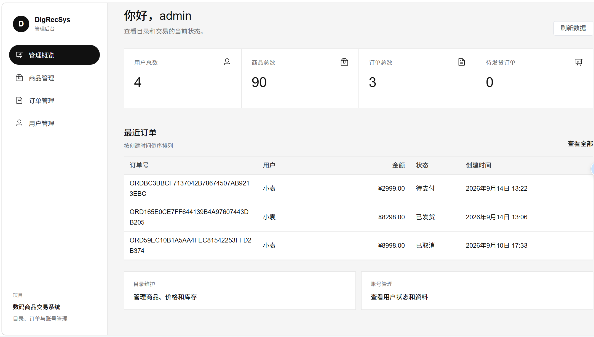
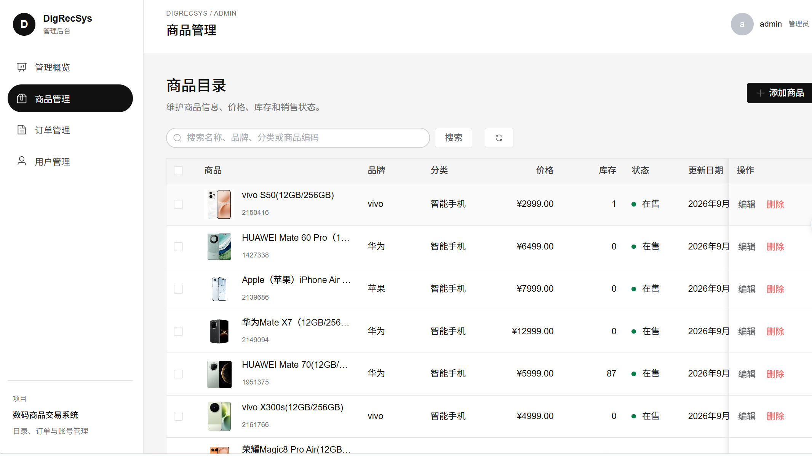
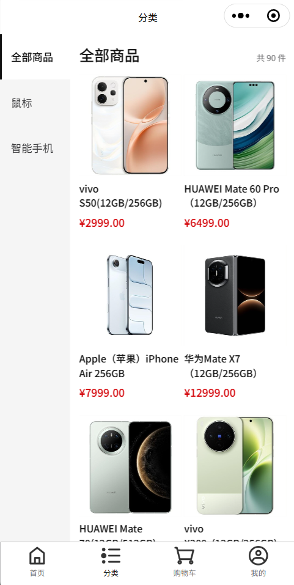
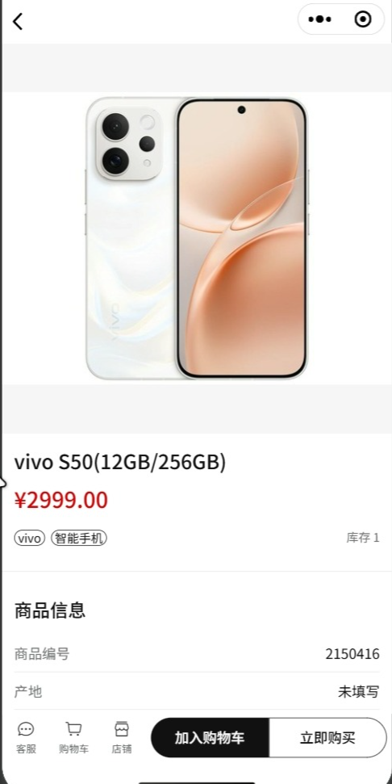

# DigRecSys

数码商品交易项目，包含 Django REST API、Vue 3 管理后台和微信原生小程序。商品采集与数据导入是可选工具。

顶层按客户端和服务端划分：`sysFronted/` 是 Vue 管理后台，`backend/` 是 Django 后端及其采集/入库工具，`miniapp/` 是微信小程序。原始采集批次保存在根目录 `data/raw/`。

## 界面预览

### 管理后台

<p align="center">
  
</p>

<p align="center">
  
</p>

### 微信小程序

<p align="center">
  
  &nbsp;&nbsp;
  
</p>

## 快速开始

### 环境与依赖

- 后端：Git、Python 3.11、MySQL 8；Python 依赖见 `backend/requirements.txt`。
- 管理后台：Node.js `^20.19.0` 或 `>=22.12.0`、npm。Vue、Vue Router、Element Plus（含图标）、Pinia、Axios、Vite 等前端依赖由 `sysFronted/package.json` 和锁文件管理，使用 `npm ci` 安装。
- 微信小程序：微信开发者工具、Node.js/npm、Vant Weapp 1.11.7；依赖及锁文件位于 `miniapp/`，使用 `npm ci` 安装。

### 1. 安装后端依赖并配置数据库

以下命令适用于 Windows PowerShell：

```powershell
git clone https://github.com/HurricaneEd/DigRecSys.git
cd DigRecSys
python -m pip install -r backend/requirements.txt
```

在 MySQL 中创建数据库：

```sql
CREATE DATABASE digrecsys1
  CHARACTER SET utf8mb4
  COLLATE utf8mb4_unicode_ci;
```

运行迁移并启动 API：

```powershell
python backend/manage.py migrate
python backend/manage.py runserver 127.0.0.1:8000
```

### 2. 启动管理后台

保持 Django API 运行，另开一个 PowerShell 窗口：

```powershell
cd sysFronted
npm ci
npm run dev
```

打开 Vite 输出的本地地址并访问 `/admin`（默认 `http://localhost:5173/admin`）。开发服务器会将 `/api` 和 `/media` 请求代理到 `http://127.0.0.1:8000`。如需更改后端地址，可在 `sysFronted/.env` 中设置：

```dotenv
VITE_BACKEND_ORIGIN=http://127.0.0.1:8000
VITE_API_BASE_URL=/api
```

使用 `python backend/manage.py createsuperuser` 创建管理员账号；后台要求用户的 `is_staff=True`，Django 超级用户默认满足。登录调用 `/api/users/login/`，后续管理请求使用 DRF Token 认证。

### 3. 启动微信小程序（可选）

保持后端运行，在另一个 PowerShell 窗口安装小程序依赖：

```powershell
cd miniapp
npm ci
```

API 地址集中配置在 `miniapp/utils/config.js`，默认是 `http://127.0.0.1:8000/api`，适用于本机开发者工具连接本地后端。真机调试需改用手机可访问的局域网地址或已备案的 HTTPS 域名，并在微信公众平台配置 request 合法域名。

小程序页面包括首页搜索与商品分页、分类、商品详情、登录注册、购物车、个人中心、个人资料编辑、订单列表、订单确认和订单详情。`miniapp/utils/` 集中封装 API 地址、请求、接口、商品格式化及订单状态展示。

手工检查小程序时，可验证首页搜索、分类切换与分页、商品详情、登录、分类页左右区域滚动等主要交互；

## 管理后台说明

`sysFronted/` 是项目正式维护的 Vue 3 管理界面，面向当前 Django API，包含管理概览、商品、订单、用户和个人资料功能。

生产构建命令：

```powershell
cd sysFronted
npm ci
npm run build
```

产物位于 `sysFronted/dist/`。部署时需由静态站点托管并配置 history 路由回退到 `index.html`。Django 已占用 `/admin/` 提供 Django 管理站点，因此 Vue 后台应部署在独立站点源。生产环境将 `VITE_API_BASE_URL` 配为浏览器可访问的完整 API 前缀（例如 `https://api.example.com/api`），并配置 API 允许该站点跨域访问；Vite 代理只用于本地开发。

## 导入商品数据（可选）

正式导入前先对原始批次执行 dry-run，并检查导入统计：

```powershell
python backend/database/import_products.py data/raw/<批次号>/products_raw.xlsx --dry-run
```

采集与导入工具分别位于 `backend/crawl/` 和 `backend/database/`。

## API 文档与开发检查

| 入口 | 地址 |
| --- | --- |
| Swagger | <http://127.0.0.1:8000/swagger/> |
| ReDoc | <http://127.0.0.1:8000/redoc/> |
| 商品 API | <http://127.0.0.1:8000/api/products/> |
